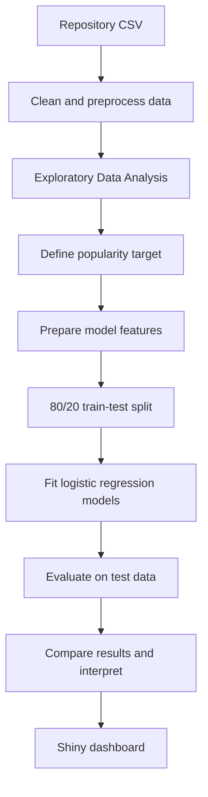
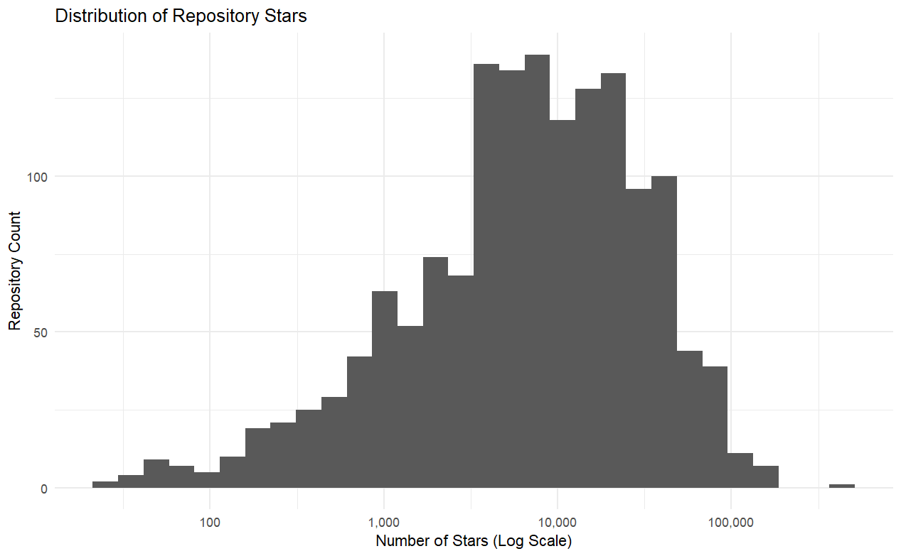
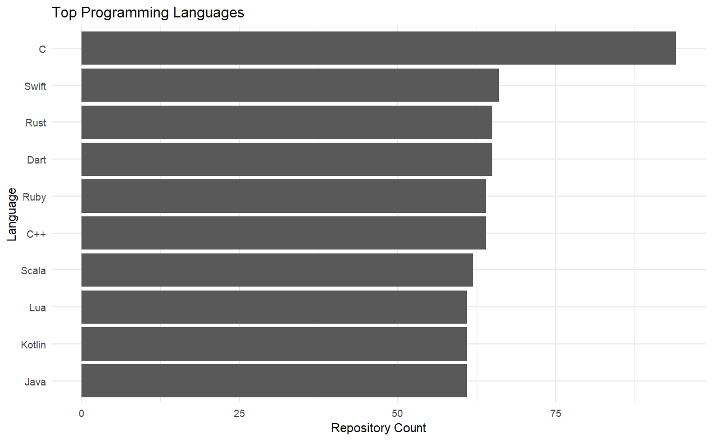
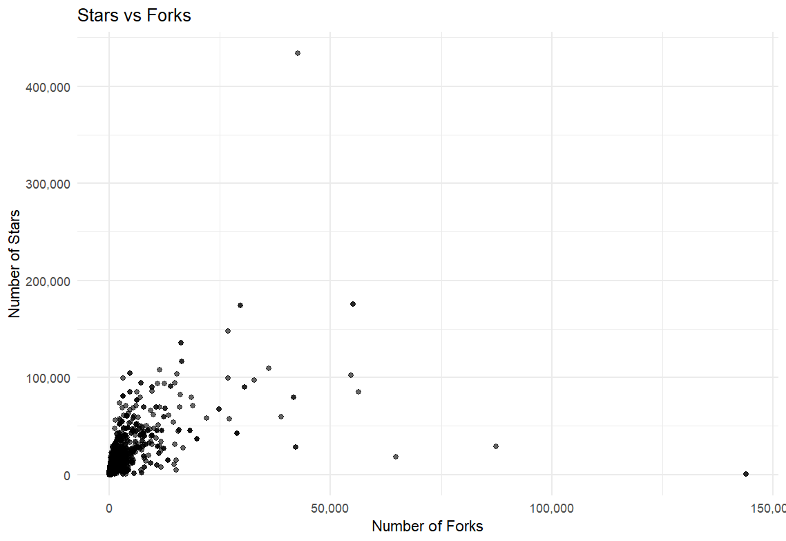
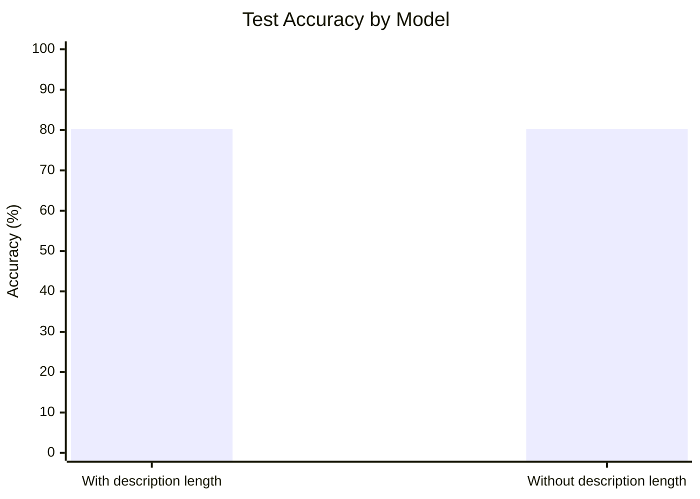
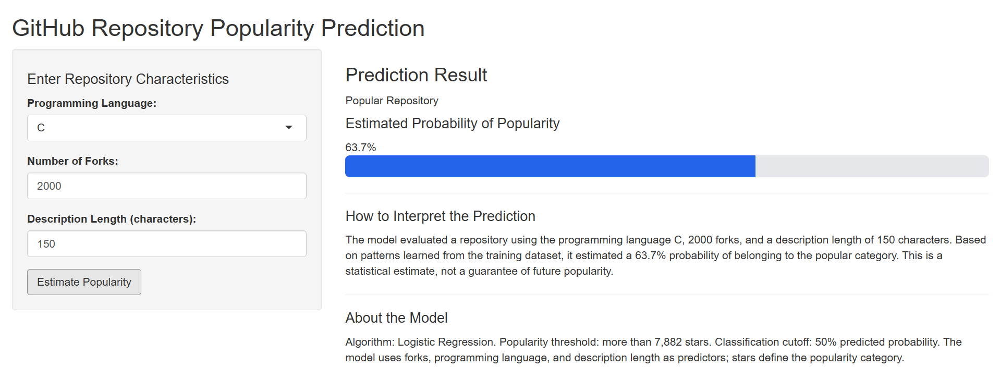

<div align="center">

# What Makes a GitHub Repository Popular?
### A Data Science Approach

Exploring repository characteristics and classifying GitHub repositories as **Popular** or **Not Popular** using logistic regression.


</div>

---

## Table of Contents
- [Overview](#overview)
- [Objectives](#project-objectives)
- [Dataset](#dataset)
- [Technology Stack](#technology-stack)
- [Workflow](#project-workflow)
- [Exploratory Data Analysis](#exploratory-data-analysis)
- [Popularity Definition](#popularity-definition)
- [Model](#machine-learning-model)
- [Evaluation](#model-evaluation)
- [Key Findings](#key-findings)
- [Dashboard](#interactive-dashboard)
- [Project Structure](#project-structure)
- [How to Run](#how-to-run)
- [Limitations and Future Work](#limitations-and-future-work)
- [Author](#author)

## Overview

GitHub hosts repositories for applications, libraries, tools, and research projects. Some repositories attract more stars and forks than others. This project explores repository characteristics and builds a logistic regression classifier to classify repositories as **Popular** or **Not Popular**.

The predictors used are:
- **Forks:** the number of times a repository has been forked.
- **Programming language:** the repository's primary language.
- **Description length:** the number of characters in its description.

The project includes data cleaning, exploratory data analysis (EDA), feature preparation, logistic regression, test-set evaluation, model comparison, and a Shiny dashboard (`app.R`, if included).

> **Scope note:** The model classifies repositories using their observed star counts in the supplied dataset. It does not predict future popularity or prove that any feature causes popularity.

## Project Objectives

1. Clean and inspect the GitHub repository dataset.
2. Explore stars, forks, programming languages, and description lengths.
3. Examine relationships between stars and selected features.
4. Define a reproducible binary popularity target.
5. Train a logistic regression classifier.
6. Evaluate its predictions on a held-out test set.
7. Compare models with and without description length.
8. Provide an accessible dashboard for trying predictions.

## Dataset

The analysis uses `data/github_trending_repos.csv`.

| Column | Description | Use |
|---|---|---|
| `full_name` | Repository identifier, usually `owner/repository` | Identification / deduplication |
| `language` | Repository's programming language | Predictor |
| `stars` | Observed star count | Defines target; excluded from predictors |
| `forks` | Repository fork count | Predictor |
| `description` | Repository description text | Used to derive description length |
| `timeframe` | Timeframe associated with the record | Dataset context / deduplication |
| `description_length` | Derived number of characters in description | Predictor in full model |

### Data preparation

The R script selects required columns, removes duplicate repository/timeframe records, converts stars and forks to numeric values, handles missing or blank language/description values, calculates `description_length`, removes invalid negative or non-finite numeric values, and groups infrequent language categories into `Other` where applicable.

The exact number of rows depends on the CSV version used. Run the script to reproduce the row count for your copy.

## Technology Stack

| Technology | Purpose |
|---|---|
| **R** | Data preparation, analysis, and modeling |
| **ggplot2** | Visualizations |
| **dplyr** | Data manipulation |
| **readr** | CSV import |
| **Base R `glm()`** | Logistic regression (`family = binomial`) |
| **Shiny** | Interactive dashboard, if `app.R` is included |
| **RStudio** | Recommended development environment |

## Project Workflow



## Exploratory Data Analysis

EDA is performed in `analysis.R` before model evaluation. It uses summary statistics, correlation calculations, and visualizations to understand the dataset and investigate potential patterns.

### 1. Distribution of repository stars



This chart helps examine the spread of repository star counts and whether the distribution is skewed. If a logarithmic axis is used, zero-star values need special handling because zero cannot be represented on a log scale.

### 2. Top programming languages



This chart shows which programming languages occur most often in the collected repository data. Language is also treated as a categorical predictor in the classifier.

### 3. Stars versus forks



This scatter plot explores whether repositories with more forks also tend to have more stars. A relationship does not establish causation.

### Correlation results

The current analysis produced these values:

| Variables | Correlation | Interpretation |
|---|---:|---|
| Forks and stars | `0.4719` | Moderate positive linear association |
| Description length and stars | `0.0301` | Very weak linear association |

Correlation measures linear association, not causation. A low correlation alone does not prove that a feature has no predictive value; this is why the models were compared on the same test set.

## Popularity Definition

The target is based on the median star count in the prepared dataset:

- **Popular (`1`):** `stars > median(stars)`
- **Not Popular (`0`):** `stars <= median(stars)`

Equivalent R logic:

```r
data$popularity <- ifelse(
  data$stars > median(data$stars, na.rm = TRUE),
  1,
  0
)
```

This creates a binary classification problem. The threshold is dataset-relative, not a universal definition of popularity.

**Why not use `stars` as a predictor?** Stars define the target label. Including stars among the model inputs would leak the information used to generate the answer, so it is excluded from the predictors.

## Machine Learning Model

### Logistic regression

Logistic regression estimates the probability that a record belongs to the Popular class based on the selected predictors.

**Full model predictors**
- `forks`
- `language`
- `description_length`

**Simpler model predictors**
- `forks`
- `language`

### Train-test split

The current script uses an **80% training / 20% testing split** with random seed `123` for reproducibility on the same dataset and environment.

### Model comparison

| Model | Predictors | Test accuracy |
|---|---|---:|
| Full logistic regression | Forks + language + description length | **80.26%** |
| Simpler logistic regression | Forks + language | **80.26%** |

Adding description length did not change accuracy on the current split. The simpler model may be easier to explain, but additional metrics and prediction-level comparisons are needed before deciding that description length has no value.

## Model Evaluation

The final reported confusion matrix is:

| Actual class | Predicted Not Popular (`0`) | Predicted Popular (`1`) | Total |
|---|---:|---:|---:|
| Not Popular (`0`) | 119 | 26 | 145 |
| Popular (`1`) | 34 | 125 | 159 |
| **Total** | **153** | **151** | **304** |

The model correctly classified `119 + 125 = 244` of the `304` test records.

### Metrics

| Metric | Result | Meaning |
|---|---:|---|
| **Accuracy** | **80.26%** | Percentage of all test records classified correctly |
| **Precision (Popular)** | **82.78%** | Of records predicted Popular, the percentage actually Popular |
| **Recall (Popular)** | **78.62%** | Of actually Popular records, the percentage identified |
| **F1-score (Popular)** | **80.65%** | Harmonic mean of Popular-class precision and recall |

Precision, recall, and F1-score here treat Popular (`1`) as the positive class.

### Confusion matrix interpretation

- **119 true negatives:** Not Popular repositories correctly predicted Not Popular.
- **125 true positives:** Popular repositories correctly predicted Popular.
- **26 false positives:** Not Popular repositories incorrectly predicted Popular.
- **34 false negatives:** Popular repositories incorrectly predicted Not Popular.

### Accuracy comparison chart

The following chart uses the reported test results; it is not a new model run.



## Key Findings

1. Forks and stars have a moderate positive correlation in this dataset (`r ≈ 0.472`).
2. Description length and stars have almost no linear correlation (`r ≈ 0.030`).
3. Both models achieved **80.26% test accuracy** on the current split.
4. Adding description length did not improve accuracy in this experiment.
5. The final reported model correctly classified **244 of 304 test records**.
6. Popular-class precision was **82.78%**, and recall was **78.62%**.
7. The results classify observed popularity according to a median-based label; they do not establish future popularity.

## Interactive Dashboard

If `app.R` is included, the Shiny application lets users enter repository characteristics and obtain a Popular / Not Popular classification.

Place the dashboard screenshot at `assets/Dashboard.png` for the image below to render on GitHub.



Inputs may include programming language, fork count, and description length. Ensure the dashboard applies the same feature transformations as the analysis model. A prediction is an estimate, not a guarantee of future success.

## Project Structure

```text
GitHub-Trending-Analysis-Simplified/
├── data/
│   └── github_trending_repos.csv
├── assets/
│   ├── DistributionOfRepoStars.png
│   ├── TopLanguages.png
│   ├── StarsVsForks.png
│   └── Dashboard.png
├── analysis.R
├── app.R
└── README.md
```

If the dashboard screenshot has another filename, rename it to `Dashboard.png` or change the image path in this README. Do not commit API keys, credentials, or other secrets.

## How to Run

### Prerequisites

Install R and optionally RStudio. Install the packages used by the analysis:

```r
install.packages(c("ggplot2", "dplyr", "readr", "scales"))
```

If using the Shiny dashboard:

```r
install.packages("shiny")
```

### 1. Clone the repository

Replace the placeholder with the actual GitHub repository URL:

```bash
git clone <YOUR-REPOSITORY-URL>
cd GitHub-Trending-Analysis-Simplified
```

### 2. Check the dataset path

Ensure the CSV exists at:

```text
data/github_trending_repos.csv
```

For portability, prefer a relative path in `analysis.R`, for example:

```r
data <- readr::read_csv("data/github_trending_repos.csv")
```

Run the script from the project root.

### 3. Run the analysis

Open `analysis.R` in RStudio and click **Source**, or run:

```r
source("analysis.R")
```

This should run the preparation, EDA, model comparison, and evaluation steps.

### 4. Run the dashboard

If `app.R` is included and configured:

```r
shiny::runApp()
```

Run the command from the project directory. Follow any additional model-loading requirements implemented in `app.R`.

## Limitations and Future Work

### Limitations

- **Dataset-relative target:** the median threshold changes with the dataset.
- **Not a future predictor:** the target is based on observed stars, not future star growth.
- **One split:** results may vary with another train/test split; cross-validation would provide a more robust estimate.
- **Limited predictors:** contributor count, repository age, commit activity, issues, topics, and README quality are not included.
- **Correlation is not causation:** the analysis does not establish cause and effect.
- **Potential logistic regression warning:** if R reports fitted probabilities numerically equal to 0 or 1, investigate possible complete/quasi-complete separation or rare factor levels.
- **Dataset scope:** results apply to the supplied dataset and its collection process, not necessarily to all GitHub repositories.

### Future improvements

1. Use repeated cross-validation.
2. Report metrics for both classes and consider ROC-AUC.
3. Compare logistic regression with a decision tree or random forest using the same evaluation procedure.
4. Examine alternative thresholds and class balance.
5. Add relevant repository metadata if available and permitted.
6. For a true future-popularity project, collect features at an initial time and predict later star growth over a clearly defined time window.
7. Use relative file paths and document dataset provenance and licensing.
8. Include a dashboard screenshot and a live demo link if deployed.

## Author

**Ankith Achar**  
BE, Computer Science and Engineering  
Malnad College of Engineering, Hassan, Karnataka, India

- GitHub: [Ankith-Achar-27](https://github.com/Ankith-Achar-27)

---

<div align="center">

Built with R, exploratory data analysis, and logistic regression.

</div>
